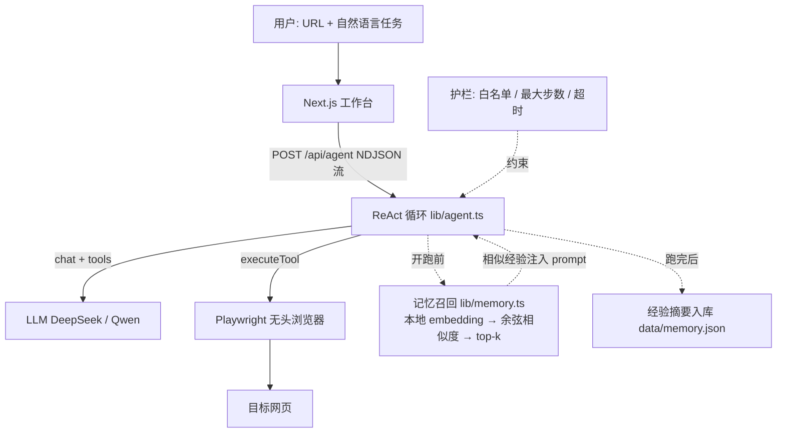

# WebPilot

自然语言驱动的浏览器自动化 Agent 工作台。

用户输入一句自然语言任务（例如「打开待办页面，添加 3 条待办，并断言数量为 3」），Agent 自主规划步骤、调用 Playwright 操作浏览器、截图、断言、失败重试，最后生成报告。前端实时展示 Agent 的每一步思考、工具调用和结果。

> 这是一个用于求职的实战项目骨架，定位：**LLM 应用开发 / Agent 应用工程师**。

## 核心亮点

- **手写 ReAct 执行循环**：决策 → 工具调用 → 观察 → 再决策，不依赖任何 Agent 框架，便于理解并讲清 function calling 底层原理。
- **8 个浏览器工具**：`goto` / `getSnapshot` / `getAccessibilityTree` / `click` / `type` / `press` / `assertText` / `assertCount`，覆盖导航、观察、交互、断言。
- **可访问性树 + 精简元素快照**：用 `getSnapshot` 给模型提供「元素 → 建议 CSS 选择器」的映射，比塞整段 DOM 省 token、定位更稳。
- **任务记忆（RAG）**：每次任务结束，把「成败 + 踩坑过程」确定性摘要成经验，用本地多语言 embedding 向量化入库；下次任务先按语义检索 top-k 历史经验注入 prompt。embedding 走本地 ONNX 模型，不走 API。
- **实时过程可视化**：NDJSON 流式推送每一步的工具名、参数、结果与页面截图，记忆的召回/写入也在界面上可见，把黑盒推理变成可调试的产品界面。
- **安全护栏**：最大步数、整体超时、域名白名单。
- **成本可观测**：报告页展示步数、耗时、prompt/completion token 数。

## 架构



```
lib/agent.ts       ReAct 循环 + 截图 + 护栏 + 记忆召回/写入的接入点
lib/llm.ts         OpenAI 兼容客户端（DeepSeek / Qwen）
lib/tools.ts       8 个工具的 schema + 执行器
lib/guardrails.ts  域名白名单
lib/memory.ts      任务记忆：本地 embedding + 向量存储 + top-k 检索（RAG）
```

## 快速开始

前置：Node.js 18+，网络可访问 DeepSeek（或 Qwen）。

```bash
# 1. 安装依赖
npm install

# 2. 下载 Chromium（Playwright 需要，约 100MB，只需一次）
npm run setup

# 3. 配置模型
cp .env.example .env.local
# 编辑 .env.local，填入 LLM_API_KEY（DeepSeek 或 Qwen）

# 4. 启动
npm run dev
```

打开 http://localhost:3000 ，点击「运行 Agent」即可看到默认演示（打开 `public/todo.html`，添加 3 条待办并断言）。

## 默认演示脚本

- URL：`http://localhost:3000/todo.html`（`public/todo.html`，一个内置的极简待办页）
- 任务：`打开这个待办事项页面，依次添加 3 条待办：买牛奶、写周报、预约体检。然后断言列表里恰好有 3 条待办。`

预期流程：Agent 先 `getSnapshot` 拿到 `#todo-input`、`#add-btn`、`.todo-item` 等选择器 → 逐条 `type` + `click` 添加 → `assertCount(".todo-item", 3)` 校验 → 输出最终总结。

## 可复现验证

Agent 有随机性，「跑一次成功」说明不了问题。`npm run verify` 会自己起一个静态服务器提供
`public/todo.html`（不需要先开着 `npm run dev`），跑固定用例，输出步数与 token 成本 ——
它回答的是「改了 prompt 之后，到底是变好还是变差」。

```bash
npm run verify              # 跑全部用例
npm run verify -- --only 2  # 只跑第 2 条
```

当前四条用例的实测结果（`deepseek-chat`，`temperature: 0`）：

| 用例 | 步数 | 耗时 | prompt | completion | 断言 | 结果 |
| --- | --- | --- | --- | --- | --- | --- |
| 添加 3 条待办 → 断言数量为 3 | 10 | 8.4s | 13236 | 455 | 2/2 | 通过 |
| 添加 1 条指定内容 → 断言文本存在 | 6 | 4.5s | 6598 | 259 | 2/2 | 通过 |
| 什么都不加 → 断言数量为 0 | 4 | 3.2s | 5180 | 182 | 1/1 | 通过 |
| 记忆收益：同任务连跑两次，第二次命中经验 | 10 | 8.1s | 14469 | 455 | 2/2 | 通过 |

通过率 **4/4**。

## 任务记忆（RAG）

Agent 不是每次都从零开始。每次任务结束后，运行过程被**确定性摘要**成一条经验入库；
下次跑新任务前，先按任务语义检索相似经验注入 prompt。

三个刻意的设计决定（面试常问）：

1. **embedding 用本地 ONNX 模型（paraphrase-multilingual-MiniLM，384 维），不走 API。**
   verify 要可复现，不能把测试成本和随机性绑在第三方接口上；选多语言模型是因为
   任务描述是中文——英文模型在中文上语义区分度太差，改写任务相似度 0.45、
   无关任务也能到 0.5，阈值没法设；多语言模型实测改写任务 0.70~0.96、无关任务 ≤0.42。
2. **经验摘要不调 LLM，纯规则生成。** 记忆写入本身不该再花钱、再引入不确定性，
   否则「记忆让结果变好」就没法归因。
3. **检索键只用任务文本，教训只作为内容存取。** 踩过的坑：把教训拼进 embedding
   会稀释任务语义——实测同任务相似度从 0.92 掉到 0.46，直接跌破召回阈值。

存储层是 JSON 文件 + 余弦相似度，检索管线（向量化 → 打分 → top-k 过滤）和向量库
完全一致；量大了把这一层换成 sqlite-vec / Qdrant，上游不用动。记忆模块任何失败
都降级为「无记忆」，绝不影响任务本身。

判定标准是「模型声明 `STATUS: DONE` + 所有断言 pass」，不看模型自己的措辞有多自信。

用例加在 `scripts/verify.ts` 顶部的 `CASES` 数组里，一条就是一句任务描述。

> **这个脚本第一次跑就抓到两个真 bug**，记在这里是因为它们很典型：
>
> 1. **代码在循环外打开了页面，却没告诉模型。** 模型不知道自己在哪一页，就自己猜 URL
>    （先猜 `example.com`，再猜 `localhost:3000`），连撞三次白名单后直接放弃任务 —— 而它
>    上一次「跑通」纯属运气：那次它碰巧改用了 `getSnapshot` 去探页面。修法是在初始导航后
>    把「页面已打开 + 当前地址」作为一条消息压进 `messages`。
> 2. **`success` 判断错了。** 原来的条件是「模型不再调用工具了」，但模型放弃任务时同样
>    不再调用工具 —— 于是失败被报成「通过」。改成优先信模型声明的 `STATUS:` 行，没有
>    就退回「有没有失败断言」。

## 目录结构

```
webpilot/
├─ app/
│  ├─ api/agent/route.ts   # NDJSON 流式 API
│  ├─ layout.tsx
│  ├─ page.tsx             # 工作台 UI（任务输入 + 时间线 + 报告）
│  └─ globals.css
├─ lib/
│  ├─ agent.ts             # ReAct 循环 + 截图 + 护栏 + 记忆接入
│  ├─ llm.ts               # LLM 客户端
│  ├─ tools.ts             # 工具 schema + 执行器
│  ├─ guardrails.ts        # 域名白名单
│  └─ memory.ts            # 任务记忆（RAG）：本地 embedding + 向量检索
├─ public/todo.html        # 内置演示站点
├─ scripts/verify.ts       # 可复现验证（npm run verify，含记忆收益用例）
├─ .env.example
└─ package.json
```

## 面试必讲清的原理

1. **function calling 底层机制**：模型输出 `tool_calls`（含 `id` + `function.name` + JSON `arguments`）→ 你执行工具 → 把结果以 `{role:"tool", tool_call_id, content}` 压回 `messages` → 再问模型。循环直到模型不再输出 `tool_calls`。
2. **循环如何停止**：靠 `MAX_STEPS` 上限 + 模型主动选择不再调用工具（`tool_choice:"auto"` 时，模型认为完成会只回文本）。
3. **上下文/token 管理**：每轮把工具结果拼回历史，token 随步数增长；所以观察信号要精简（用 `getSnapshot` 的可访问性/选择器快照，而不是整段 DOM + 全尺寸截图）。
4. **稳定性**：工具参数用 JSON Schema 约束、`temperature:0`、失败重试、断言校验。
5. **安全护栏**：域名白名单防止被诱导访问未授权站点、最大步数防止无限烧 token。

## 简历 bullet（只写你真实做了的）

- 基于 TypeScript + Playwright 独立实现自然语言驱动的浏览器自动化 Agent，手写 ReAct 执行循环（规划 → 工具调用 → 观察 → 重试），支持多步骤任务自动执行与失败重试。
- 封装 8 个浏览器工具（导航、元素快照、可访问性树、点击、输入、按键、文本断言、数量断言），以可访问性树 + 选择器快照作为观察信号，降低 token 成本并提升元素定位稳定性。
- 设计任务记忆（RAG）：本地多语言 embedding + 向量存储 + top-k 语义检索，任务经验确定性摘要后跨任务复用；检索键与内容分离、失败静默降级，四条评估用例通过率 4/4。
- 基于 Next.js + NDJSON 流式响应实现 Agent 执行过程实时可视化：步骤时间线、截图回放、记忆召回/写入状态展示，将黑盒推理过程变为可调试的产品界面。
- 内置最大步数、整体超时、域名白名单等护栏，并用可复现评估脚本持续验证任务通过率、步数与 token 成本。

## 部署说明（重要）

**不要用 Vercel 部署这个项目。** Playwright 需要无头 Chromium（几百 MB），Vercel 的 serverless 函数有体积上限和时长上限（免费版默认 10s），多步浏览器任务会超时/被砍。

正确做法：本周末先本地跑通，面试时现场开本地服务，或用 ngrok / Cloudflare Tunnel 开临时公网链接。真到部署，用 Railway / Fly.io / Render / 便宜 VPS 这类能跑长时进程 + 大镜像的平台。域名完全不用买。

## 避坑

- 别一上来上 LangGraph / 多 Agent —— 先把手写循环吃透。
- 别做通用聊天套壳 —— 这个项目的差异点是「会动手操作 + 过程可视化」。
- 别爬未授权网站 —— 用内置的 `public/todo.html`、TodoMVC、自己的页面做测试。
- 一定要录一个 1-2 分钟的 demo 视频，简历里直接放链接。
- 开源到 GitHub，写清楚 README + 架构图。

## 下一步（进阶，做进 README 的「未来工作」即可）

- 评估集扩容：`npm run verify` 目前 4 条，往 20+ 条扩，并加上重试率、幻觉率统计。
- 保险场景差异化：把 Demo 场景扩一个模拟理赔报案表单页（`public/claim.html`），贴近目标行业。
- 可观测：接 Langfuse 记录完整 trace。
- 任务队列：Redis + BullMQ 支撑并发任务。
- 存储升级：记忆量大后把 JSON 存储换成 sqlite-vec / Qdrant（检索管线不变）。
